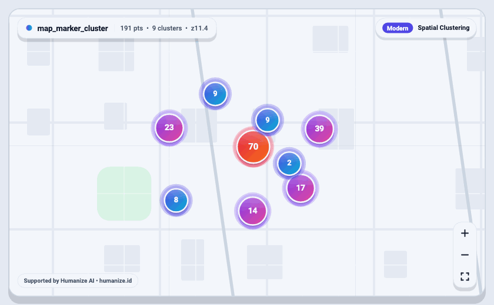
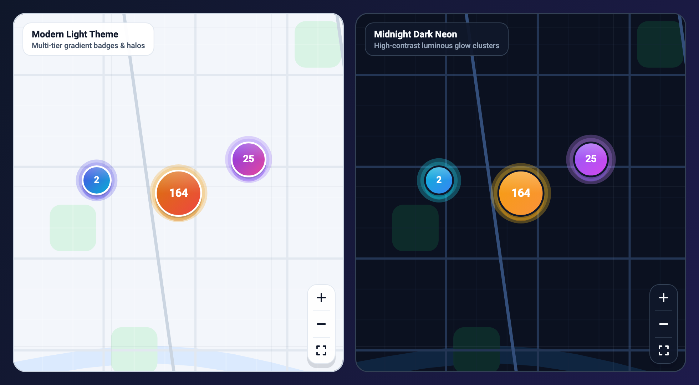
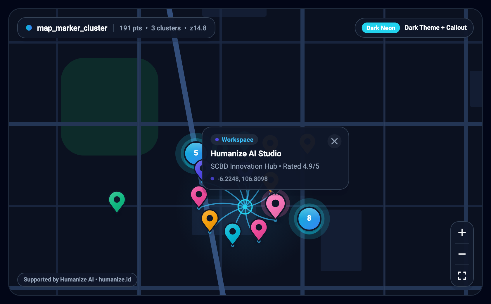

# map_marker_cluster

[](https://pub.dev/packages/map_marker_cluster)
[](https://pub.dev/packages/map_marker_cluster/score)
[](https://github.com/andikpbw/flutter-map-marker-cluster/blob/main/LICENSE)
[](https://pub.dev/packages/map_marker_cluster)
[](https://humanize.id)

<p align="center">
  
</p>

A **modern, lightweight, customizable, and provider-agnostic** map marker clustering library for Flutter — engineered with **zero third-party dependencies** and built purely on `package:flutter/widgets.dart` for full forward-compatibility with **Flutter 3.47–3.50+ / Dart 3.14+** (no deprecated `package:flutter/material.dart` imports).

<p align="center">
  
</p>

<p align="center">
  <em>Real Flutter UI output: spatial clustering, smooth zoom split &amp; merge, curved Bezier spiderfy expansion, floating callout cards, and live Dark Neon theme switching.</em>
</p>

---

## Visual Showcase

| Multi-Tier Modern Light & Midnight Dark Neon | Curved Spiderfy & Floating Marker Callout |
| :---: | :---: |
|  |  |

---

## Why `map_marker_cluster`?

- **Zero External Dependencies** — Depends strictly on the Flutter `widgets` layer (`package:flutter/widgets.dart`). Works effortlessly inside `MaterialApp` (`material_ui`), `CupertinoApp` (`cupertino_ui`), or `WidgetsApp` across **Android, iOS, Web (including Wasm), macOS, Windows, and Linux**.
- **Provider-Agnostic Overlay (`ClusterMapOverlay`)** — Layer directly above `flutter_map`, `google_maps_flutter`, `apple_maps_flutter`, Mapbox, MapLibre, or any custom map widget inside a `Stack` without intercepting map pan/pinch gestures.
- **All-in-One Interactive Map (`InteractiveClusterMap`)** — Includes smooth 1:1 panning, focal-point pinch & mouse-wheel zoom, double-tap zoom, animated camera transitions, floating zoom/fit controls, and a procedural `VectorMapBackdrop`.
- **`O(n)` Pan-Stable Spatial Hash Engine** — Evaluates clusters in absolute Web Mercator world pixels at quantized zoom buckets, guaranteeing **zero cluster flicker during panning**, antimeridian-safe (`±180°`) weighted centroids, and smooth 60–120 FPS performance with thousands of markers.
- **Smart Radial & Spiral Spiderfy** — Automatically fans out co-located or max-zoom clusters along symmetric circles or non-overlapping Archimedean spirals with animated curved Bezier legs.
- **4 Curated Modern Themes + Total Customization** — Ships with `ClusterThemeData.modern()`, `dark()`, `minimal()`, and `emerald()` presets (all supporting `ClusterThemeData.lerp`), plus full custom `clusterBuilder`, `markerBuilder`, `calloutBuilder`, and custom `MapProjection` hooks.

---

## Installation

Add `map_marker_cluster` to your `pubspec.yaml`:

```yaml
dependencies:
  map_marker_cluster: ^1.0.0
```

Then run:

```bash
flutter pub get
```

---

## Quick Start

### 1. All-in-One Interactive Map

Drop `InteractiveClusterMap` anywhere in your widget tree for instant clustering with pan, pinch/wheel zoom, spiderfy, and floating callout cards:

```dart
import 'package:flutter/widgets.dart';
import 'package:map_marker_cluster/map_marker_cluster.dart';

class PlacesClusterView extends StatelessWidget {
  const PlacesClusterView({super.key});

  @override
  Widget build(BuildContext context) {
    final markers = <ClusterMarker<String>>[
      const ClusterMarker<String>(
        id: 'studio',
        position: GeoPoint(-6.2248, 106.8098),
        label: 'Humanize AI Studio',
        subtitle: 'SCBD Innovation Hub',
        category: 'Workspace',
      ),
      const ClusterMarker<String>(
        id: 'cafe',
        position: GeoPoint(-6.2252, 106.8102),
        label: 'Senopati Brew Lab',
        subtitle: 'Specialty Coffee & Bakery',
        category: 'Cafe',
        accentColor: Color(0xFFEC4899),
      ),
      const ClusterMarker<String>(
        id: 'transit',
        position: GeoPoint(-6.2088, 106.8235),
        label: 'Bundaran HI Station',
        subtitle: 'North-South Express Line',
        category: 'Transit',
        accentColor: Color(0xFF06B6D4),
      ),
    ];

    return InteractiveClusterMap<String>(
      initialCenter: const GeoPoint(-6.2185, 106.8165),
      initialZoom: 12.0,
      markers: markers,
      theme: ClusterThemeData.modern(),
    );
  }
}
```

---

### 2. Provider-Agnostic Overlay (Use with Any Map Package)

Combine `ClusterMapOverlay` with `flutter_map`, `google_maps_flutter`, Mapbox, or your own map renderer by feeding the current `MapViewport` camera state:

```dart
import 'package:flutter/widgets.dart';
import 'package:map_marker_cluster/map_marker_cluster.dart';

class ExternalMapWithClusters extends StatelessWidget {
  const ExternalMapWithClusters({
    required this.viewport,
    required this.markers,
    super.key,
  });

  final MapViewport viewport;
  final List<ClusterMarker<String>> markers;

  @override
  Widget build(BuildContext context) {
    return Stack(
      fit: StackFit.expand,
      children: <Widget>[
        // Replace with FlutterMap, GoogleMap, MapboxMap, or your custom map:
        VectorMapBackdrop(viewport: viewport),
        ClusterMapOverlay<String>(
          markers: markers,
          viewport: viewport,
          theme: ClusterThemeData.dark(),
          onClusterTap: (ClusterNode<String> cluster) {
            // Animate your map provider camera to cluster.bounds.center
            // and cluster.expansionZoom.
          },
          onMarkerTap: (ClusterMarker<String> marker) {
            // Handle marker selection or open your detail sheet.
          },
        ),
      ],
    );
  }
}
```

---

### 3. Reactive Control & Live Filtering with `ClusterController`

```dart
final controller = ClusterController<String>(
  initialCenter: const GeoPoint(-6.2088, 106.8456),
  initialZoom: 11.5,
  initialMarkers: markers,
  options: const ClusterOptions(
    clusterRadius: 64.0,
    maxClusterZoom: 15.5,
    tapBehavior: ClusterTapBehavior.zoomThenSpiderfy,
    spiderfyShape: SpiderfyShape.auto,
  ),
);

// Live category filter without losing the original dataset
controller.setMarkerFilter((m) => m.category == 'Cafe');

// Smoothly fit all active markers in view
controller.fitMarkers();

// Programmatically spiderfy a specific cluster
if (controller.visibleNodes.isNotEmpty && controller.visibleNodes.first.isCluster) {
  controller.spiderfyCluster(controller.visibleNodes.first);
}
```

---

### 4. Customizing Themes & Builders

Pick a built-in preset or fully customize badges, pins, and callouts:

```dart
// Built-in presets
final modern = ClusterThemeData.modern();
final darkNeon = ClusterThemeData.dark();
final minimal = ClusterThemeData.minimal();
final emerald = ClusterThemeData.emerald();

// Custom builders
ClusterMapOverlay<String>(
  controller: controller,
  theme: darkNeon.copyWith(
    pulseAnimation: true,
    curvedSpiderLegs: true,
    countFormatter: (int count) => count > 99 ? '99+' : '$count',
  ),
  clusterBuilder: (context, cluster, theme) {
    return DefaultClusterBadge<String>(cluster: cluster, theme: theme);
  },
  markerBuilder: (context, marker, theme, {required isSelected}) {
    return DefaultMarkerPin<String>(
      marker: marker,
      theme: theme,
      isSelected: isSelected,
    );
  },
  calloutBuilder: (context, marker, onClose, theme) {
    return DefaultMarkerCallout<String>(
      marker: marker,
      theme: theme,
      onClose: onClose,
    );
  },
);
```

---

## Configuration Reference

| Option (`ClusterOptions`) | Default | Description |
| :--- | :---: | :--- |
| `clusterRadius` | `64.0` | Pixel radius within which markers merge into a cluster. |
| `minClusterSize` | `2` | Minimum markers required to form a cluster. |
| `maxClusterZoom` | `16.0` | Zoom above which separated markers uncluster (co-located markers remain spiderfiable). |
| `zoomBucketStep` | `1.0` | Zoom quantization step ensuring zero flicker during panning. |
| `cullToViewport` | `true` | Skips rendering nodes outside viewport + `cullMargin` for high FPS on huge datasets. |
| `tapBehavior` | `zoomThenSpiderfy` | Choose between `zoomThenSpiderfy`, `spiderfy`, `zoomToBounds`, or `none`. |
| `spiderfyShape` | `auto` | Uses a circle for small clusters (`<= 8`) and an Archimedean spiral for larger ones. |
| `maxSpiderfyCount` | `24` | Caps fanned-out markers per spiderfy and displays a `+N` badge on the anchor hub. |

---

## Architecture Highlights

- **`ClusterEngine<T>` & `SpatialHashGrid<T>`** — Pure Dart 3 spatial hashing with `(int, int)` record keys (safe across native 64-bit, JS 53-bit, and Wasm).
- **`WebMercatorProjection` & `MapProjection`** — EPSG:3857 projection with polar clamping (`±85.0511°`), rotation support, and shortest-path antimeridian wrapping (`±180°`).
- **Accessibility & Motion Hygiene** — Full `Semantics` labels on clusters, pins, callout actions, and controls; automatically honors `MediaQuery.disableAnimationsOf(context)`.

---

## Support & Sponsors

This library is proudly supported by **[Humanize AI](https://humanize.id)**.

If `map_marker_cluster` helps your Flutter project, consider starring the repository on [GitHub](https://github.com/andikpbw/flutter-map-marker-cluster), filing feedback or feature requests on the [issue tracker](https://github.com/andikpbw/flutter-map-marker-cluster/issues), and visiting **[Humanize AI](https://humanize.id)**.

---

## License

Released under the [MIT License](LICENSE) — Copyright (c) 2026 Humanize AI Indonesia.
